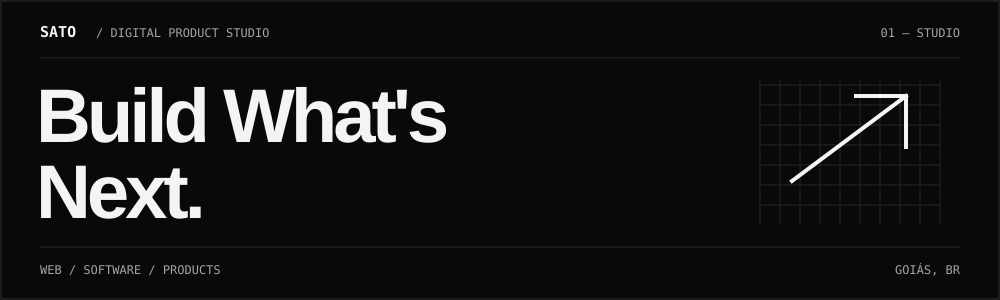

<div align="center">

<a href="https://sato-studios.vercel.app/">
  
</a>

<br />

**Estúdio independente de produtos digitais.**

Criamos sites, softwares e produtos digitais para empresas prontas para evoluir.

[Website ↗](https://sato-studios.vercel.app/) · [Instagram ↗](https://www.instagram.com/sato_studios/) · [Iniciar um projeto ↗](https://sato-studios.vercel.app/#contact)

### 01 / PRODUTOS EM DESTAQUE

<table>
<tr>
<td width="50%" valign="top">

#### <a href="https://github.com/satostudios/Neku">Neku ↗</a>

Um agente de IA local para Windows 11 que reside na barra de tarefas.

<code>Python</code> <code>IA Local</code> <code>Código Aberto</code>

<sub>SATO × Vetra</sub>

</td>
</tr>
</table>

### 02 / O QUE CRIAMOS

| | |
| :--- | :--- |
| **01 — Websites** | Sites responsivos, landing pages e experiências digitais. |
| **02 — Software** | Plataformas personalizadas, dashboards e sistemas internos. |
| **03 — Produtos** | SaaS, MVPs, aplicativos desktop e integrações. |

### 03 / COMO TRABALHAMOS

```text
01 DESCOBRIR → 02 PLANEJAR → 03 CONSTRUIR → 04 LANÇAR → 05 EVOLUIR
```

Estúdio enxuto. Comunicação direta. Cuidado técnico em cada detalhe.

Escolhemos nossas ferramentas de acordo com cada projeto, não por hábito.

---

### 04 / VAMOS CONSTRUIR

Tem uma ideia? Vamos transformá-la em algo útil.

[**Iniciar um projeto ↗**](https://sato-studios.vercel.app/#contact)

---

<sub>SATO © 2026 / ESTÚDIO DE PRODUTOS DIGITAIS</sub>

</div>
