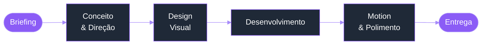

 

---

### 01 / About

**Sato Studios** é um estúdio criativo que explora a interseção entre **design**, **tecnologia** e **desenvolvimento de software**. Do visual ao código, passando por motion, cada projeto nasce com intenção e termina com acabamento.

---

### 02 / Featured project

## [Neku ↗](https://github.com/satostudios/Neku)

**Agente de IA local para Windows 11 que vive na barra de tarefas.**

`Python` · `Local AI` · `Open Source`

*Parceria Sato Studios × Vetra*

---

### 03 / Como trabalhamos

---

### 04 / Stack

---

### 05 / Em números

---

### 06 / Contato

---

  
  SATO STUDIOS — Creative Development

